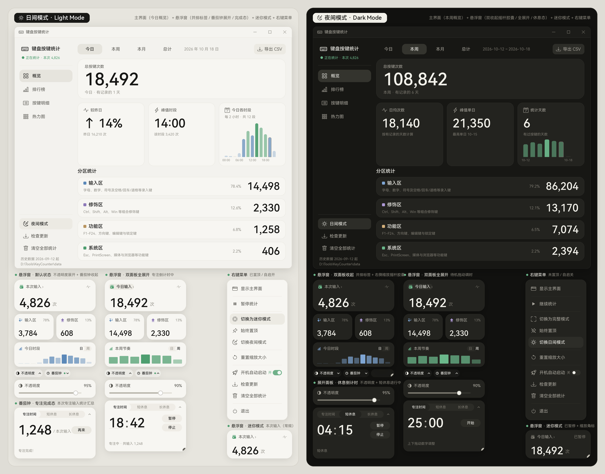

# 声明

**本软件 100% AI生成！**  
（95% Deepseek 4.1flash，5%Gemini Argon，感谢柔情猫娘在肥鱼听不懂我对美化的要求时的伟大帮助）  
没错，连发布都是DS办到的！  
发布该仓库，只是因为我需要为更新版本提供一个地方，发给我朋友的时候就不用再甩zip了。  
~~而且万一有人用呢。~~

# KeyCounter介绍

一个轻量的 Windows 键盘按键统计小工具。启动后常驻一个半透明圆角悬浮窗，  
实时显示本次按键数；右键即可打开完整统计界面，按「今日 / 本周 / 本月 / 总计」  
查看按键次数、排行榜、按键明细与键盘热力图。支持日间 / 夜间主题。  

**只统计程序运行期间的按键；只累加每个键被按了多少次，不记录任何输入内容。**

  

# KeyCounter 发布仓库

本仓库只存放 **键盘按键统计（KeyCounter）** 的免安装发布包与版本清单。
这里提供可直接运行的 Windows 版本。

## 下载

到 [Releases](https://github.com/sherjor/KeyCounter-releases/releases/latest) 下载
`KeyCounter-*-win64.zip`，解压到任意目录，双击 `KeyCounter.exe`。

- Windows 10 / 11（64 位）
- 无需安装 Python
- 统计数据保存在程序旁的 `data\` 目录；卸载直接删除整个文件夹

## 功能

- 半透明圆角悬浮窗，实时显示本次 / 今日按键数，可切换迷你模式  
- 底部「不透明度」「番茄钟」两个入口标签可独立展开 / 收起，也可同时展开  
- 内建番茄钟：专注 / 短休息 / 长休息，可拖动调时长，专注时统计本次输入  
- 概览、排行榜、按键明细、热力图（104 / 87 / 82 键）  
- 今日 / 本周 / 本月 / 总计四种统计范围  
- 日间 / 夜间主题、开机自启动、CSV 导出  
- 只统计程序运行期间的按键，不记录输入内容，不联网  

## 悬浮窗与番茄钟

- 悬浮窗由四张常驻卡片组成：本次 / 今日、输入区、修饰区、今日时段 / 本周节奏；
- 底部并排「不透明度」「番茄钟」两个入口标签，各自展开 / 收起；
- 两个面板可同时展开，也可以只开一个或全部收起；全部收起时右侧出现与
  入口同高的第三个圆角矩形，里面是缩放手柄；
- 三个入口矩形左右各内缩 8px（随缩放比例），彼此等间距，右侧矩形吃掉
  剩余宽度；
- 番茄钟专注时间默认 25:00，短休息 5:00，长休息 15:00，三个阶段的时长各自保存；
- 鼠标按在分钟或秒上上下拖动即可调整；
- 支持开始、暂停、继续、停止与「再来」；
- 专注阶段统计本次输入，暂停期间不计数，完成后显示数量；
- 收起后计时继续运行，入口右侧小绿点表示专注中。

## 自动更新

程序内右键悬浮窗 →「检查更新」，或主界面左下角「检查更新」。  
更新器从本仓库的 `latest.json` 读取版本，下载后校验 SHA-256 再替换文件；  
统计数据保存在 `data\`，不会被覆盖。

## 许可与第三方

程序使用 [Bootstrap Icons](https://github.com/twbs/icons)（MIT）、
[HarmonyOS Sans SC](https://developer.harmonyos.com/cn/docs/design/des-guides/font-0000001157868583)
字体子集、[Pillow](https://github.com/python-pillow/Pillow)（HPND）等第三方资源，
随包保留相应声明。
